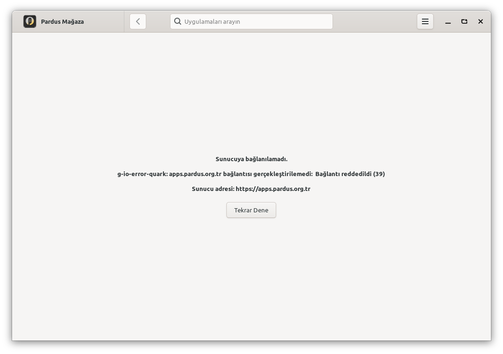
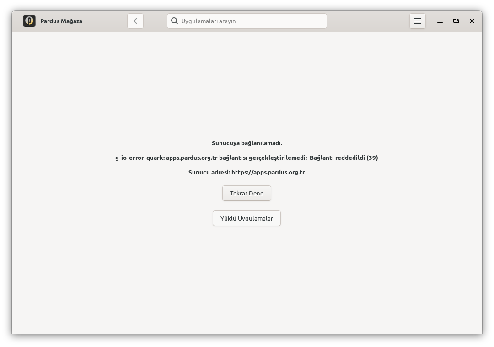
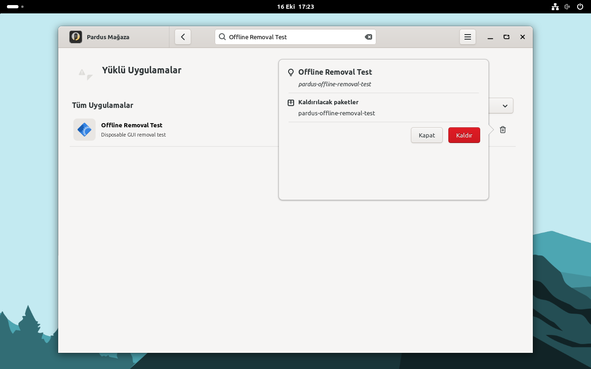
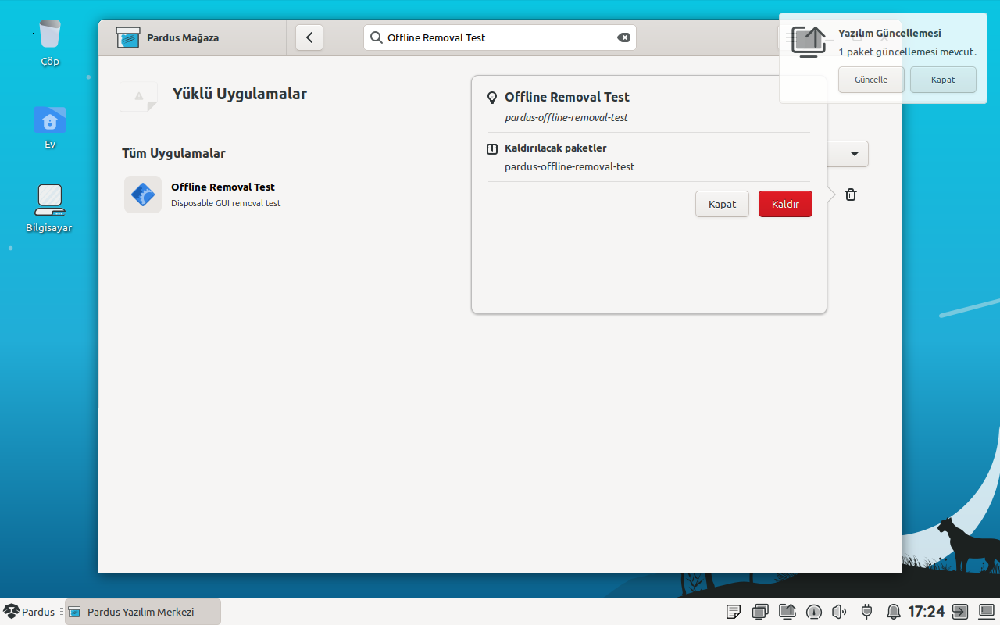

# Pardus 23 ve GNOME doğrulaması

16 Ekim 2026. PR: [pardus/pardus-software#63](https://github.com/pardus/pardus-software/pull/63).
Test edilen kaynak `84844cbf566cf339c9784cf61850e62bd0303c34`, yamasız taban
`d99c804a7c2be9828248cbb8c52fc7fab46ba409`. Bu doğrulamada ürün kodunu değiştirmedim.

| Ortam | GTK testleri | Debian paketi | Gerçek çevrimdışı akış | Çevrimiçi kontrol |
|---|---|---|---|---|
| Pardus 25.2, GNOME 48.7, X11, Python 3.13 | 10/10 | derlendi ve kuruldu | geçti | geçti |
| Pardus 23.5, XFCE, X11, Python 3.11 | 10/10 | derlendi ve kuruldu | geçti | geçti |

Pardus 25 laboratuvarına GNOME paketlerini ekleyip GDM üzerinden gerçek GNOME
Xorg oturumu açtım. Bu, ayrı bir GNOME kurulum medyası veya Wayland testi değil.
Pardus 23 laboratuvarı bağımsız diskte çalıştı. İki dağıtımda da resmî Mağaza
paketi 1.0.6; 23'ün yirmiuc deposundaki aday paket [hazırlık kaydında](p23-prepare.log)
görülebilir. Eski 0.8.x sürümüne geri taşıma yapılmadı.

## GTK testleri ve derleme

Uygulamanın README bağımlılıkları, Debian derleme bağımlılıkları ve `xvfb xauth` ile:

```sh
xvfb-run -a python3 tests/offline_navigation.py
dpkg-buildpackage -b -us -uc
```

Aynı 10 test yamasız kaynakta çalıştırıldı: çevrimdışı davranışı kapsayan 7 test
metodu hatayı yakaladı; 3 çevrimiçi kontrol geçti. İzin alt durumları nedeniyle
unittest toplam 10 başarısız doğrulama sayıyor. Testler gerçek widget ve metotları
kullanıyor; sunucu/izin/APT durumu test girdisi, işçiler başlatılmıyor.
Debian derlemesinin varsayılan keşfi 0 test çalıştırıyor; GTK komutunu ayrıca çalıştırdım.

| Kayıt | Pardus 25 | Pardus 23 |
|---|---|---|
| Yamasız GTK | [çıktı](p25-tests-before.log) | [çıktı](p23-tests-before.log) |
| Yamalı GTK | [çıktı](p25-tests-after.log) | [çıktı](p23-tests-after.log) |
| Paket derlemesi | [çıktı](p25-build.log) | [çıktı](p23-build.log) |
| Ortam / özgün dosyalar | [GNOME](p25-gnome-environment.log), [paket](p25-baseline.log) | [paket ve SHA](p23-before-snapshot.log) |
| Kurulu yamalı dosyalar / son sağlık kontrolü | [SHA-256 ve APT](p25-health-after.log) | [SHA-256 ve APT](p23-health-after.log) |

Deney sonunda yalnız bu iki laboratuvar kendi başlangıç anlık görüntülerine döndü.
Resmî 1.0.6 dosya sağlamaları, `dpkg --audit` ve APT kontrolü temiz; test paketi ve
ağ engeli yok ([Pardus 25](p25-restored.log), [Pardus 23](p23-restored.log)).

## Gerçek uygulama ve kaldırma

Derlenen paketler VM'lere kuruldu. Kurulu `Main.py`, gerçek ağ istemcisi, APT ve
normal GTK döngüsü kullanıldı; uygulama metotları taklit edilmedi. Çevrimdışı
deneyde önbellek boşaltıldı, dış bağlantılar nft ile reddedildi. SSH yönetim ağı
açık kaldı. Aynı başlangıç koşullarında yamasız arayüz listeye geçiş sunmuyordu.

Yamalı arayüzde yeni düğmeye gerçek fare olayı gönderildi. Diğer kontroller
odak değişimi ve gerçek GTK sinyalleriyle çalıştırıldı. Her iki ortamda liste,
ayarlar/geri, Mousepad araması, ayrıntı/geri, gerçek Mousepad sürecinin başlaması,
kaldırma, geri dönüş ve ağ engeli kaldırılınca **Tekrar Dene** kontrol edildi.
Ayrıca çevrimiçi liste/ayarlar/arama/ayrıntı/çalıştırma/geri akışı geçti.

Kaldırma için `pardus-offline-removal-test` adlı bağımlılıksız, bakım betiği
olmayan bir test paketi kullandım. Yalnız bir masaüstü girdisi var; `Exec=/usr/bin/true`.
Onay penceresinde yalnız bu paketin seçildiği denetlendi. Ardından gerçek APT
kaldırması tamamlandı:

| Kontrol | GNOME / Pardus 25 | XFCE / Pardus 23 |
|---|---|---|
| Yerel liste | 100 → 99 | 90 → 89 |
| `dpkg-query` | paket bulunamadı, çıkış 1 | paket bulunamadı, çıkış 1 |
| Test paketinin masaüstü dosyası | yok | yok |
| APT bozuk bağımlılık sayısı | 0 | 0 |
| Kaldırma sırasında sunucu bağlantısı | kapalı | kapalı |

Deney hesabı uygulamanın mevcut `pardus-software` grubuna eklendi; özel polkit
kuralı yazılmadı. Parola isteme penceresi bu deneyin kapsamında değil.

| Senaryo | GNOME / Pardus 25 | XFCE / Pardus 23 |
|---|---|---|
| Yamasız çevrimdışı | [JSON](p25-gnome-before.json), [log](p25-gnome-before.log) | [JSON](p23-xfce-before.json), [log](p23-xfce-before.log) |
| Yamalı çevrimdışı + kaldırma + yeniden bağlantı | [JSON](p25-gnome-after.json), [log](p25-gnome-after.log) | [JSON](p23-xfce-after.json), [log](p23-xfce-after.log) |
| Yamalı çevrimiçi | [JSON](p25-gnome-online.json), [log](p25-gnome-online.log) | [JSON](p23-xfce-online.json), [log](p23-xfce-online.log) |

## Ekran görüntüleri

Gerçek GTK penceresi ve masaüstünden alındı. Görseller üzerinde düzenleme yapılmadı.
Kaldırmanın tamamlandığına ilişkin kanıt, görüntüye ek olarak yukarıdaki dpkg,
dosya, liste sayısı ve APT kontrolleridir.

GNOME, aynı boş önbellek ve kapalı bağlantı koşulları:

| Önce | Sonra |
|---|---|
|  |  |

GNOME üzerinde gerçek kaldırma onayı:



Pardus 23 XFCE üzerinde aynı işlem:



[Pardus 23 önce](p23-xfce-before-startup.png) ·
[Pardus 23 sonra](p23-xfce-after-startup.png) ·
[GNOME yerel liste](p25-gnome-after-installed-desktop.png) ·
[GNOME arama](p25-gnome-after-search.png) ·
[Pardus 23 kaldırma sonrası liste](p23-xfce-after-removed.png) ·
[Pardus 23 yeniden bağlantı](p23-xfce-after-retry.png).

## Ek gözlem ve sınırlar

İlk tamamlanan iki çevrimdışı kaldırma akışında, listeyi temizleyip bağlantı
ekranına geri dönerken `gtk_widget_draw: assertion '!widget->priv->alloc_needed' failed`
çıktı. Uygulama kapanmadı; kaldırma ve yeniden bağlantı kontrolleri geçti.
Yamasız kodun çevrimiçi gerçek kaldırma [kontrolünde](p25-base-online-remove.log)
bu uyarı yoktu. Pardus 23'te GTK çağrı izleme eklenerek tekrarlanan aynı çevrimdışı
akışta da uyarı çıkmadı ([JSON](p23-draw-trace.json), [log](p23-draw-trace.log)).
Gerçek widget'larla liste/filtreleme/popover/silme/geri dönüşü çalıştıran küçük
[deney](software-stack-draw-probe.py) de üretmedi ([çıktı](draw-probe-popover.log)).
Kök nedeni kesinleşmedi; bu gözlemi çözülmüş bir hata olarak sunmuyorum.

İlk GUI denemelerinde odak, çizim ve gecikmiş arama sinyalini bekleme eksikleri
test aracında düzeltildi; ürün kodu değişmedi. Buradaki ana kayıtlar tamamlanmış
koşulara aittir. Tekil süreler performans ölçümü olarak kullanılmamalı.

Açılıştaki ağ zaman aşımı ve katalog önbelleğinin çevrimdışı kullanımı değişmedi.
Boş önbellekte liste başlığı simgesi bulunamıyor; görüntülerde de görünüyor.
Yerel uygulama simgeleri ve işlemleri çalışıyor. Wayland ve parola isteyen
kaldırma yolu denenmedi. [Önceki Pardus 25 XFCE kanıtları](../README.md), izin ve
bozuk APT kontrollerini ayrıca içeriyor.

## Deney araçları

- [GUI akışı](software-ready-gui.py): kurulu uygulamayı çalıştırır, doğrular ve görüntü alır.
- [Çalıştırıcı](software-ready-run.py): gerçek masaüstü ortamını alır, ağ engelini kurup kaldırır.
- [Test paketi](software-ready-fixture.py): yalnız bağımsız laboratuvara kurulacak geçici paket.
- [Son kontrol](software-ready-health.py): kurulu dosyalar, paket sağlığı ve temizlik.

Araçlar genel kullanıcı makinesine yönelik değildir: yalnız iki belirlenmiş
laboratuvar hostname'inde çalışırlar. VM anlık görüntüsü ve parolasız sudo gerekir;
çalıştırıcı laboratuvar kullanıcısının Mağaza önbelleğini siler. `~/software-ready/`
altına araçlar, `source/` altına belirtilen PR kaynağı ve üst dizine derlenen `.deb`
konur. `xdotool`, `nftables`, GTK bağımlılıkları ve açık X11 oturumu gerekir.

Yamalı paket kurulduktan sonra, bu laboratuvar koşullarında kullanılan sıra:

```sh
python3 ~/software-ready/software-ready-fixture.py
python3 ~/software-ready/software-ready-run.py p25-gnome-after --desktop gnome-shell --network offline --remove
python3 ~/software-ready/software-ready-run.py p25-gnome-online --desktop gnome-shell --network online
python3 ~/software-ready/software-ready-health.py
```

XFCE için masaüstü argümanı `xfce4-session`. Yamasız ölçüm özgün paket dosyaları
kuruluyken `--baseline --network offline` ile alındı; `--baseline` dosyaları
değiştirmez. JSON ve görüntüler `~/software-ready/results/` altında oluşur.
