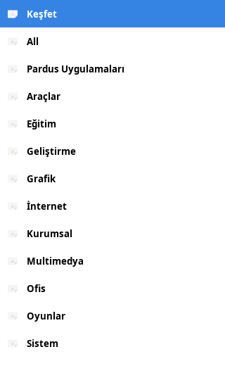
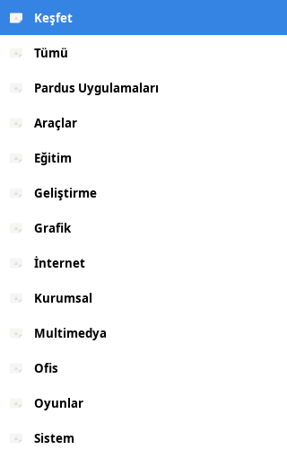

# PR #61 ve #62 inceleme ölçümleri

## 16 Ekim 2026 — güncellenen dalların doğrulanması

Pardus 25.2 XFCE VM'de aynı betikler güncel PR başlarında tekrar çalıştırıldı.
PR #61 `69953ca958e7fd49c3e271a56e6c98dd4d854d4d` üzerinde Türkçe kategori
`Tümü`, internet kategorisi `İnternet`; sonuç başarılı.
[Ölçüm](followup-20261016/pr61-result.json) ·
[Gerçek kategori widget'larının görüntüsü](followup-20261016/pr61-categories.png).
Bu görüntü test penceresidir, uygulamanın tamamı değildir.

PR #62 `ade65a9b572b67a91d0694c681dfe32b9be8596d` üzerinde eski dizindeki
`[DEFAULT]`, yeni dizindeki `[DEFAULT]` ve mevcut `[MAIN]` olmak üzere üç senaryo
da geçti. İki taşıma durumunda 7 tercih korunuyor; mevcut `[MAIN]` dosyası
bayt düzeyinde değişmiyor. [Tam ölçüm](followup-20261016/pr62-migration.json).
Bu sonuç önceki incelemede bildirilen üç senaryoyu doğrular; PR'ın bütün
davranışlarına verilmiş genel onay değildir. Kullanıcı ayarları değiştirilmedi.

## 15 Ekim 2026 — ilk inceleme

15 Ekim 2026, Pardus 25.2 XFCE sanal makinesi.
İncelenen commit'ler: #61 `8583901a5124621d5f96caca5c9240770b5e6d39`,
#62 `fa949dc34cf746ee4af3bf2db2b3de89bc8d53f1`.

## #61 — Türkçe Tümü kategorisi

`po/tr.po` içindeki `All → Tümü` kaydı `#~` ile eski kayıt olarak işaretli.
`msgfmt` bu kaydı `.mo` dosyasına almıyor. Yeni `get_category_display_name('tümü')`
çağrısı Türkçe yerelde `All` döndürüyor. Eski kod doğrudan sunucunun `tümü` adını
gösteriyordu. Etkinleştirilen çeviri kaydıyla çıktı tekrar `Tümü` oluyor.

Uygulama bağımlılıkları, gettext, Xvfb ve Türkçe UTF-8 yereli olan bir ortamda:

```sh
LANG=tr_TR.UTF-8 LC_ALL=tr_TR.UTF-8 LANGUAGE=tr xvfb-run -a \
    python3 pr61-category-check.py /path/to/pr61 cats.json /tmp/category-result
```

Test, gerçek `MainWindow.set_categories()` metodunu VM'deki katalogdan alınmış
`cats.json` ile çalıştırır. Çeviri geçici dizinde derlenir. Görseller test penceresine
yerleştirilmiş gerçek kategori widget'larını gösterir; uygulamanın tamamı başlatılmaz.
Kurulu çeviriler veya kullanıcının ayarları değiştirilmez.

PR hali: çıkış 1, `All`. Düzeltme sonrası: çıkış 0, `Tümü`.
[Önceki sonuç](pr61-before/result.json) · [Sonraki sonuç](pr61-after/result.json).

| PR hali | Çeviri etkinleştirilince |
|---|---|
|  |  |

Uygulanabilir yama: [pr61-tr-all.patch](pr61-tr-all.patch).

## #62 — Yeni dizindeki eski dosya biçimi

0.8.3, eski dizin yoksa yeni `pardus/pardus-software` dizinini seçebiliyor;
orada yine `[DEFAULT]`, `UseDarkTheme`, `ShowGnomeComments` gibi eski biçimi yazıyor.
PR'da yeni dosya varsa taşıma bloğuna girilmiyor. Sonuçta dosya korunuyor ama
çalışan ayarlar varsayılan oluyor: koyu tema kapanıyor, otomatik güncelleme açılıyor.

Dosyayı elle hazırlamadım. Resmî depodan indirilen 0.8.3 `.deb` paketini açıp
paketin `UserSettings.createDefaultConfig()` / `writeConfig()` metotlarıyla yazdırdım.
Sonra PR'daki başlangıç sırasını (`create_default_config()` ve `read_config()`) çalıştırdım.
Bu, Pardus 25 VM'de iki sürümün ayar kodlarını karşılaştıran bir testtir;
0.8.3 paketi sisteme kurulmaz ve tam uygulama başlatılmaz.

```sh
curl -fLO https://depo.pardus.org.tr/pardus/pool/main/p/pardus-software/pardus-software_0.8.3_all.deb
dpkg-deb -x pardus-software_0.8.3_all.deb legacy-0.8.3
python3 pr62-migration-check.py \
    legacy-0.8.3/usr/share/pardus/pardus-software/src /path/to/pr62/src
```

Test her durum için geçici XDG dizinleri ve ayrı Python süreçleri kullanır.
PR haliyle çıkış 1 beklenir:

| Durum | Sonuç |
|---|---|
| Eski dizindeki `[DEFAULT]` | 7 ayar doğru taşınıyor |
| Yeni dizindeki `[DEFAULT]` | 7 ayar varsayılan okunuyor; dosya değiştirilmemiş |
| Eski dosya da varken yeni dizinde geçerli `[MAIN]` | Güncel tercihler ve dosya içeriği korunuyor |

[Tam beklenen/ölçülen değerler](pr62-migration.json) · [Paket kimliği/SHA-256](paket-0.8.3.txt).

Önerilen çözümün testi: ikinci durum da geçerken üçüncü durum korunmalı.
Yeni dizinin varlığına ek olarak dosyanın biçimi ayırt edilmeli; geçerli `[MAIN]`
tercihlerinin üzerine eski ayarlar yazılmamalı. Bu dal #62 için bir çözüm uygulamaz;
tekrarlanabilir eksik senaryoyu ve çalışan karşı örnekleri sağlar.
