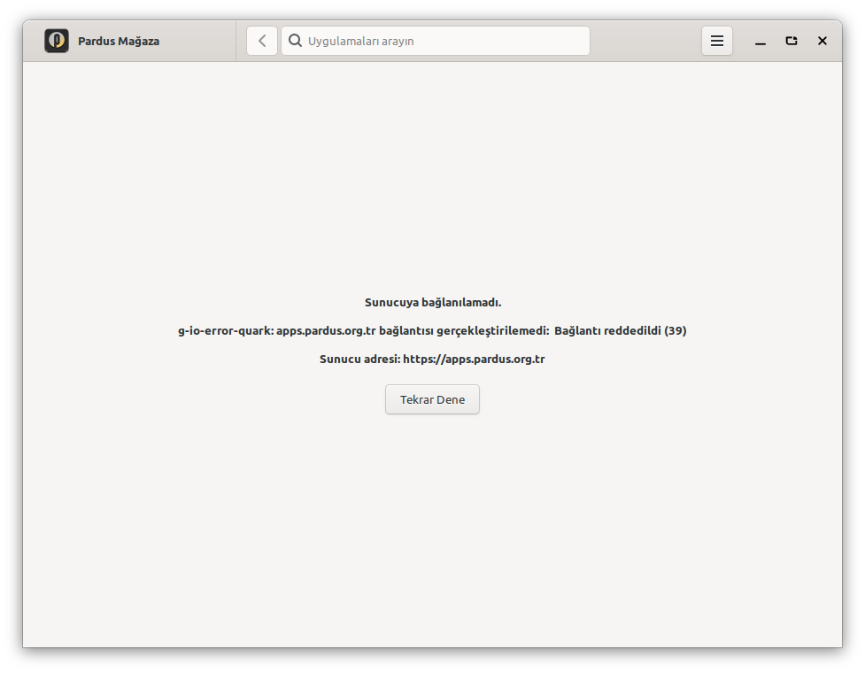
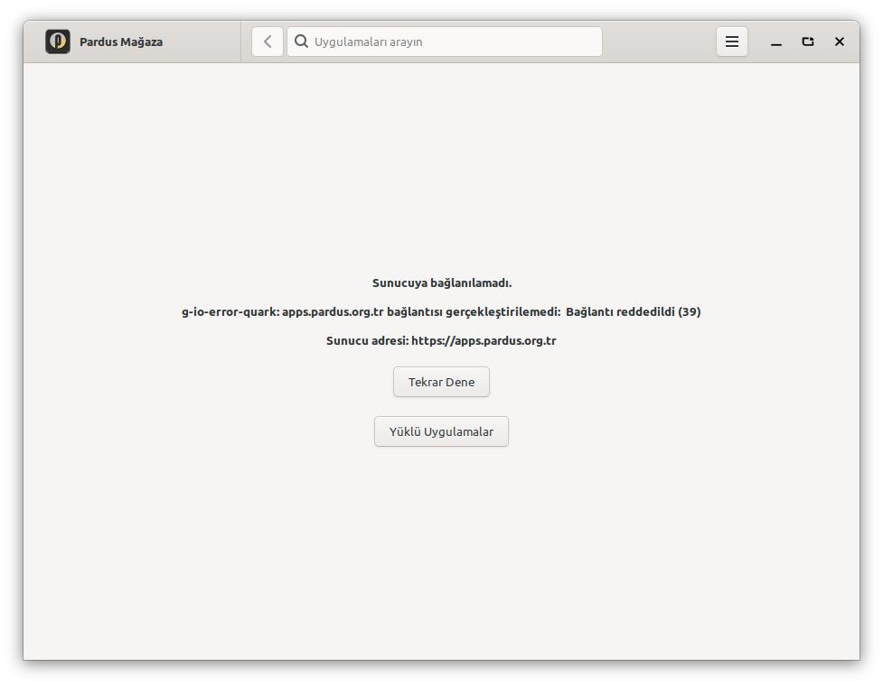
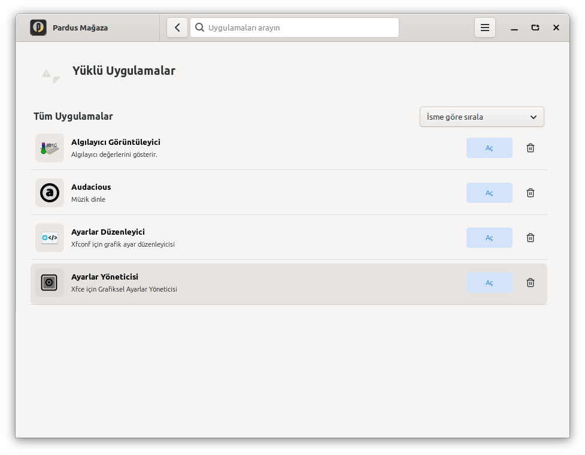
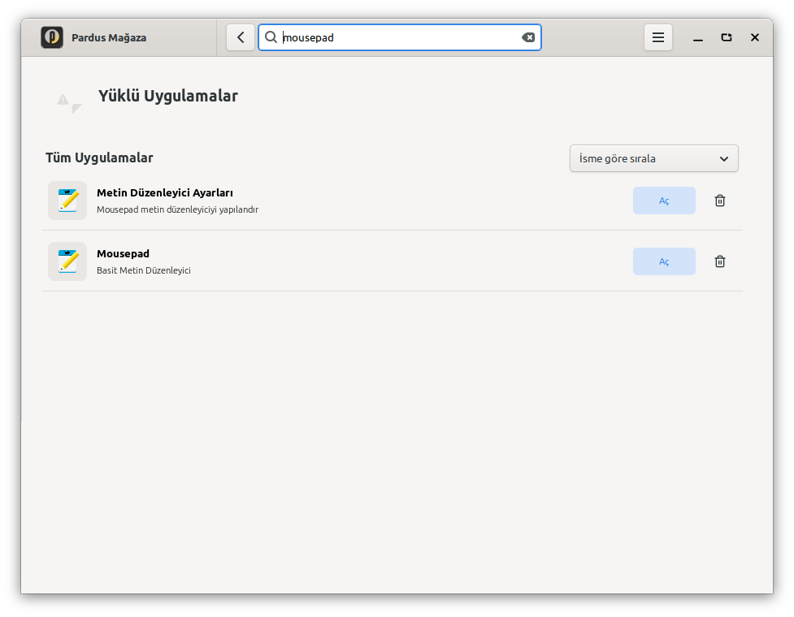

# PR #63 doğrulama kayıtları

**16 Ekim ek doğrulaması:** [Pardus 23, GNOME ve gerçek kaldırma kayıtları](2026-10-16/README.md).
Aşağıdaki kayıt 15 Ekim koşullarını anlatır; güncel kapsam ve gözlemler ek kayıttadır.

15 Ekim 2026 · Pardus 25 XFCE, KVM'de diske kurulu sistem (23'ten yükseltilmiş).
Depo paketi: `pardus-software 1.0.6`. Taban: `d99c804`.
Test edilen PR: `84844cbf566cf339c9784cf61850e62bd0303c34`.

Bu dal yalnız ölçüm kayıtlarını içerir. Uygulama değişikliği ve çalıştırılabilir
GTK testleri [PR #63](https://github.com/pardus/pardus-software/pull/63) içindedir.

## Yeniden çalıştırma

PR dalında, README'deki uygulama bağımlılıkları ve `xvfb xauth` kurulu iken:

```sh
xvfb-run -a python3 tests/offline_navigation.py
dpkg-buildpackage -b -us -uc
```

GTK testleri gerçek Glade arayüzünü ve uygulama metotlarını kullanır. Sunucu sonucu,
izin ve APT sağlık durumu test girdisidir; ağ/paket işçileri başlatılmaz.
10 test yamada geçti. Aynı test dosyası yamasız master'a kopyalanınca çevrimdışı
davranışı kapsayan 7 test başarısız, çevrimiçi davranışı kapsayan 3 test başarılı oldu.
İzin testindeki 4 alt durum nedeniyle unittest toplam 10 başarısız doğrulama sayar.
[Yamalı çıktı](denetim-gtk-yamali.log) · [Yamasız çıktı](denetim-gtk-yamasiz.log).

Debian paketi derlendi. Derlemenin varsayılan otomatik keşfi 0 test çalıştırır;
yukarıdaki GTK komutu ayrıca çalıştırılmıştır.
[Derleme çıktısı](denetim-deb-derleme.log) · [Paket içeriği ve SHA-256](denetim-paket-icerigi.txt).
Paket içindeki iki değişen uygulama dosyasının özeti VM'de denenmiş dosyalarla aynı.

## Gerçek uygulama

Kurulu 1.0.6'nın `MainWindow.py` ve `MainWindow.glade` dosyaları PR'daki karşılıklarıyla
değiştirildi. Uygulamanın ağ istemcisi, paket verisi veya metotları taklit edilmedi.
Testten sonra özgün paket dosyaları geri yüklendi.

Ekran görüntüleri gerçek GTK penceresinden alındı; Türkçe oturum için
`LANG=tr_TR.UTF-8 LC_ALL=tr_TR.UTF-8` kullanıldı.
Çevrimdışı testte VM'in dış bağlantıları reddedildi; SSH için loopback ve yerel yönetim
ağı açık kaldı. Boş önbellek senaryosunda `~/.cache/pardus/pardus-software` boşaltıldı.
Ağ engeli test sonunda kaldırıldı.

| Ölçüm | Sonuç |
|---|---|
| [Yamasız, çevrimdışı, boş önbellek](denetim-tr-yamasiz.json) | 93 uygulama hazır, listeye geçiş yok |
| [Yamalı, çevrimdışı, boş önbellek](denetim-tr-cevrimdisi.json) | Liste, ayarlar/geri, arama, ayrıntı/geri, Mousepad açma, geri, yeniden bağlantı geçti |
| [Yamalı, çevrimiçi, dolu önbellek](denetim-tr-cevrimici.json) | Liste, ayarlar/geri, arama, ayrıntı/geri, Mousepad açma, geri geçti |
| [Yamalı, çevrimdışı, bozuk bağımlılık](denetim-bozuk-apt.json) | APT `broken_count=1`; yeni düğme kapalı |

Bozuk bağımlılık, dosya ve çalıştırılabilir betik içermeyen geçici bir `.deb` paketinin
bulunmayan bir bağımlılıkla `dpkg --unpack` edilmesiyle oluşturuldu. Gerçek APT önbelleği
bir bozuk paket bildirdi. Test paketi kaldırıldıktan sonra sayı 0'a döndü ve `dpkg --audit`
temiz çıktı. Bu işlem yalnız anlık görüntüsü bulunan test VM'inde yapıldı.

Yeni düğmeye gerçek fare tıklaması yapıldı. Diğer kontroller gerçek GTK sinyalleriyle,
gereken odak değişimi de verilerek tetiklendi. Süreler tekil ölçümdür, performans iddiası değildir.

## Ekran görüntüleri

Yamasız hata ekranı:



Yamalı hata ekranı:



Yerel uygulama listesi ve arama:




[Ayarlar](denetim-tr-cevrimdisi-settings.png) ·
[Bağlantı geri gelince](denetim-tr-cevrimdisi-retry.png) ·
[Bozuk APT durumunda kapalı düğme](denetim-bozuk-apt-startup.png)

## Sınırlar

15 Ekim koşusunda GNOME, Pardus 23 paket hattı ve gerçek uygulama kaldırma işlemi denenmemişti.
Bu kontroller [16 Ekim kaydında](2026-10-16/README.md) tamamlandı.
Ağ zaman aşımı ve katalog önbelleğini çevrimdışı kullanma davranışı değiştirilmedi.
Boş önbellekte sunucudan gelen liste başlığı simgesi bulunamıyor; bu durum görüntülerde
görünüyor. Yerel uygulama simgeleri ve liste işlemleri çalışıyor.
